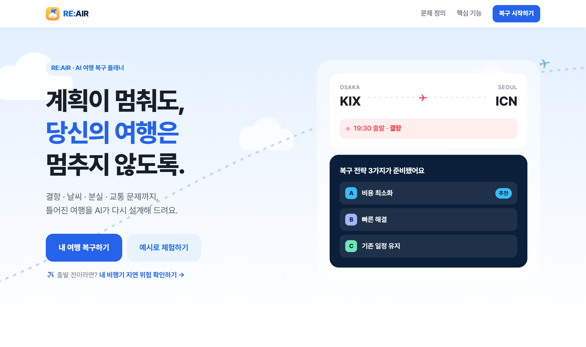
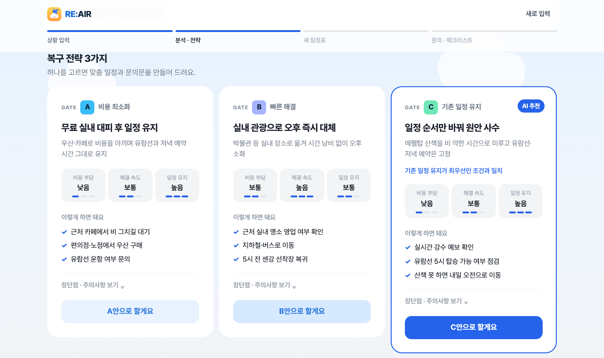
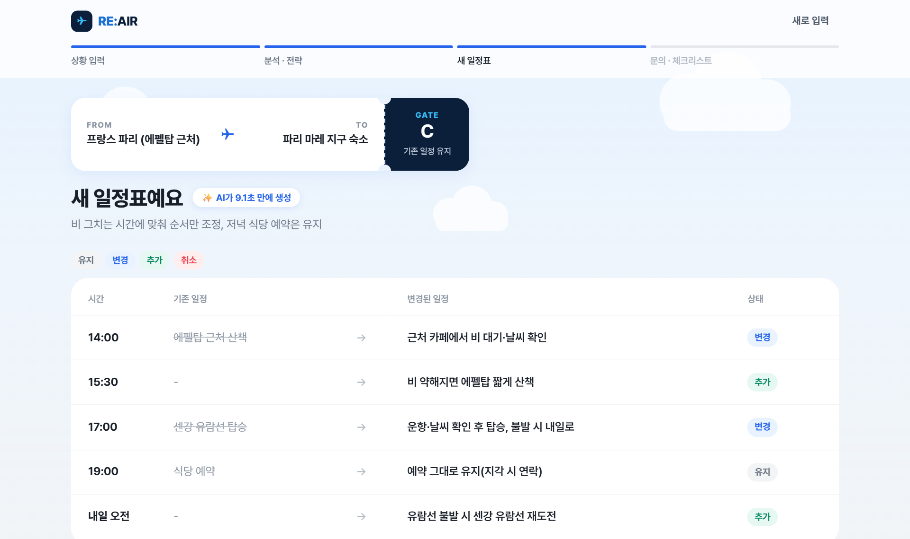
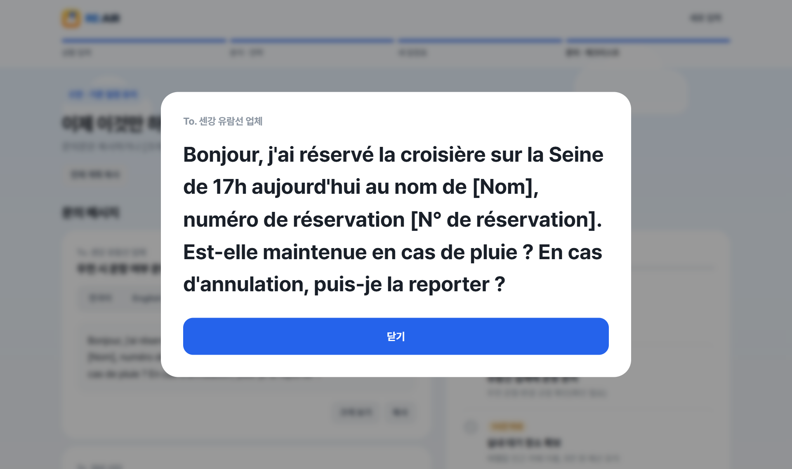
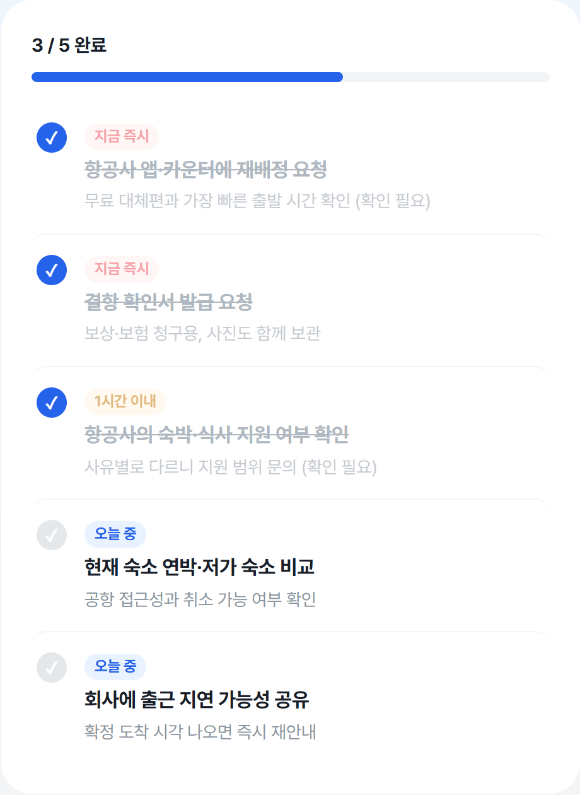
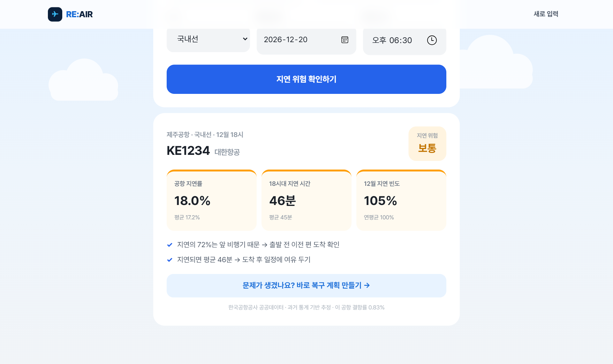

<p align="center"></p>

# RE:AIR ✈️

> **계획이 멈춰도, 당신의 여행은 멈추지 않도록.**

**결항·지연 같은 돌발 상황이 터진 뒤, 첫 30분에 해야 할 일을 대신 정리해 주는 AI 여행 복구 서비스**입니다.
생성형 AI가 연쇄 피해를 분석하고
**맞춤 복구 전략 3가지 → 새 일정표 → 현지어 문의 메시지 → 행동 체크리스트**까지 한 번에 만들어 줍니다.
출발 전에는 **공공데이터로 내 비행기의 지연 위험**을 미리 확인할 수 있어요.

> 🛬 **이런 장면을 상상해 보세요.**
> 파리 공항, 환승편이 갑자기 결항됐습니다. 숙소는 이미 예약했고, 내일 아침에는 중요한 일정이 있어요.
> 직원 앞 줄은 끝이 안 보이고, 프랑스어는 한마디도 못 합니다.
> 이때 필요한 건 *정보*가 아니라 **"지금 무엇을 해야 하는가"** 입니다.
> RE:AIR는 그 답을 전략·일정·현지어 문의문·체크리스트로, 바로 쓸 수 있게 건네줍니다.

| 한눈에 보기 | |
|---|---|
| **문제** | 돌발 상황 하나가 숙소·이동·일정·외국어 문의로 연쇄 피해를 만든다 |
| **해결** | AI가 정보가 아니라 *바로 실행할 행동 계획*으로 바꿔 준다 |
| **차별점** | 사전 예방(공공데이터 지연 위험) + 사후 복구(AI 전략)를 한 흐름으로 · 현지어 자동 작성 |

🔗 **체험하기: <https://re-air.onrender.com/>** (회원가입·설치 없이 PC와 휴대폰에서 바로 사용)
> 무료 서버라 한동안 쓰지 않으면 첫 접속에 10~30초 걸릴 수 있어요.
> 처음 써 보신다면 첫 화면의 **[예시로 체험하기]** 를 눌러 보세요.

한양여자대학교 NEXT AI 해커톤 출품작 · 빅데이터과



---

## 1. 왜 만들었나요?

여행은 계획대로 되지 않습니다. 비행기 하나가 결항되면 **숙소, 이동, 다음 날 일정, 출근·학업, 외국어 문의, 추가 비용**까지 연쇄적으로 무너집니다.
그런데 기존 서비스는 항공·숙소·교통이 따로따로이고, 누구에게나 같은 안내만 줍니다. 외국어 문의는 여전히 혼자 해결해야 하죠.

| | 기존 서비스 | **RE:AIR** |
|---|---|---|
| 범위 | 항공·숙소·교통 따로 | 연쇄 피해를 한 번에 |
| 안내 | 누구에게나 같은 안내 | 내 상황에 맞춘 전략 3가지 |
| 결과 | 정보 제공 | 일정표 · 문의문 · 할 일 |
| 언어 | 직접 번역 | 현지어 자동 작성 |
| 근거 | - | 공공데이터 기반 분석 |

> **"기존 생성형 AI에게 물어보면 되지 않나요?"** 물어볼 수는 있지만, 매번 질문을 새로 쓰고 답의 형식도 제각각입니다.
> RE:AIR는 상황을 **구조화해서 입력**받아 항상 같은 형식으로, **서로 비교할 수 있는 전략 3가지**와 **공공데이터 근거**, 그리고 **그대로 보여 주거나 복사해 쓸 결과물**(일정·문의문·체크리스트)을 줍니다.

공공데이터를 직접 분석해 보면 항공편 **지연률은 약 6편 중 1편**이고, 지연 원인의 대부분은 **앞 비행기에서 이어진 연쇄 지연**입니다.
문제 하나가 아니라 *연쇄 피해*를 해결해야 한다는 것을 데이터가 보여 줍니다.

### 기존 방법으로는 어떻게 해결하나요? (시나리오 비교)

> 상황: 해외여행 중 갑자기 몸이 아프고, 귀국 항공편까지 결항됐다.

| 해야 할 일 | 기존 방법 | RE:AIR |
|---|---|---|
| 상황 파악 · 우선순위 | 항공사 앱 · 카운터 · 검색을 오가며 직접 판단 | 한 번 입력하면 **가장 급한 일**과 영향받는 것을 정리 |
| 해결책 비교 | 대체편 · 숙소 · 교통을 각각 검색해 직접 비교 | **전략 3가지**를 비용 · 속도 · 일정 유지로 한눈에 비교 |
| 일정 재조정 | 메모 앱이나 머릿속에서 직접 다시 짬 | 기존 ↔ 변경 **일정표** 자동 생성 |
| 현지어 문의 | 번역기에 문장을 직접 입력하고 다듬음 | 상황에 맞는 **현지어 문의문** 자동 작성, `크게 보기`로 바로 제시 |
| 할 일 정리 | 해야 할 일을 기억에 의존 | 시간대별 **체크리스트**와 진행 막대 |

> ※ 사용자 테스트로 소요 시간을 측정한 결과가 아니라, 필요한 행동을 단계별로 비교한 *시나리오*입니다. 실제 효과를 사용자 테스트로 검증하는 것은 다음 과제입니다.

---

## 2. 주요 기능

### ① 여행 복구 플래너 (돌발 상황이 생겼을 때)
`상황 입력 → AI 분석 · 전략 → 새 일정표 → 문의문 · 체크리스트` 4단계로 진행됩니다.

1. **상황 입력** — 문제 유형 7가지(항공 · 교통 · 숙소 · 날씨/휴관 · 분실/도난 · 건강 · 기타), 현재 위치와 목적지, 급한 정도, 예산, 우선순위(비용 최소화 · 빠른 해결 · 기존 일정 유지 · 편안함/안전)를 고릅니다. `예시로 채우기` 버튼도 있어요.
2. **AI 상황 분석** — 지금 가장 급한 일, 영향받는 것들(일정·숙박·이동 등과 심각도), 먼저 확인할 사항을 정리합니다. 항공 문제라면 실제 공공데이터 통계를 근거로 한 *"데이터로 보면"* 인사이트가 함께 나옵니다.
3. **복구 전략 3가지** — 서로 다른 A·B·C 전략을 만들고, 비용 부담 · 해결 속도 · 일정 유지를 막대로 비교해 보여 줍니다. 입력한 우선순위에 가장 맞는 전략에 **AI 추천**이 붙습니다. 장단점과 주의사항은 펼쳐 볼 수 있어요.



4. **새 일정표** — 고른 전략에 맞춰 일정을 다시 짜고, 기존 일정과 비교해 `유지 · 변경 · 추가 · 취소`로 표시합니다.



5. **현지어 문의 메시지** — 숙소·역·매표소 등 상황에 맞는 곳에 보낼 문의문을 **한국어 · English · 현지어**로 만듭니다. 현지어는 AI가 위치를 보고 스스로 고릅니다(예: 파리 → Français). `복사`하거나, `크게 보기`로 직원에게 화면을 그대로 보여 줄 수 있어요.



6. **행동 체크리스트** — `지금 즉시 · 1시간 이내 · 오늘 중`으로 우선순위를 나눠 줍니다. 직접 체크하면 취소선이 그어지고 진행 막대(예: 3/5 완료)가 올라갑니다. `전체 계획 복사`로 메모 앱에 그대로 옮길 수도 있어요.



### ② 출발 전 지연 위험 체크 (빅데이터)
편명 · 출발 공항 · 국내/국제선 · 출발 날짜와 시간을 입력하면, **같은 공항 · 같은 시간대 · 같은 달**의 과거 운항 통계로 지연 위험을 `낮음 · 보통 · 높음`으로 알려 줍니다.
요인별 비교(공항 지연률, 시간대별 평균 지연 시간, 월별 지연 빈도)와 데이터 기반 대비 팁이 함께 나오며, 이 기능은 **AI 호출 없이 데이터만으로 계산**합니다.
결과 화면의 **[바로 복구 계획 만들기]** 버튼으로 복구 플래너로 바로 이어집니다.



### ③ 시연·편의 기능
- **AI 오류 대비** — AI가 응답하지 못하면 `다시 시도` 또는 `시연용 데이터로 보기`로 이어 갈 수 있습니다.
- **예시로 체험하기** — 입력 없이 예시 상황으로 전체 흐름을 바로 체험합니다.
- **앱 설치(PWA)** — 휴대폰 홈 화면에 앱처럼 추가할 수 있고, PC·모바일 화면에 모두 대응합니다.

---

## 3. 데이터 활용 (한국공항공사 공공데이터)

공공데이터포털의 한국공항공사 자료 3종을 Python으로 직접 읽어 집계했습니다. (`flight_stats.py`)

| 파일 | 내용 |
|---|---|
| `data/airport_delay.csv` | 공항별 지연 현황 (운항·지연 편수, 원인별 건수) |
| `data/airport_cancel.csv` | 공항별 결항 현황 (계획·결항 편수, 원인별 건수) |
| `data/hourly_delay.csv` | 2017~2025년 월·시간대별 지연 (여객, 지연 편수, 지연 시간) |

- **위험도 계산**: `공항 지연률 ÷ 전국 평균`, `시간대 평균 지연 시간 ÷ 전체 평균`, `월별 지연 빈도 ÷ 연평균`을 각각 구하고, 그 평균이 0.9 미만이면 *낮음*, 1.15 이상이면 *높음*, 그 사이는 *보통*으로 분류합니다.
- **AI에 근거 전달**: 항공 문제로 상황 분석을 요청하면 이 통계를 `<data>`로 함께 넘겨, AI가 숫자에 근거한 인사이트를 쓰게 합니다.
- **한계(솔직하게)**: 인천공항은 한국공항공사 관할이 아니라 데이터에 없습니다. 또 편명별 기록이 아니라 *같은 조건의 과거 통계로 추정*한 값이라, 실제 지연을 예측·보장하지 않습니다.

### 빅데이터과 전공과의 연결

이 서비스의 근거는 **직접 분석한 공공데이터**이고, 분석 결과가 서비스의 방향과 기능을 바꿨습니다.

1. **수집 · 정제** — 한국공항공사 CSV 3종을 Python으로 읽어 공항 · 노선 · 월 · 시간대별로 집계했습니다.
2. **지표 설계** — 공항 지연률, 시간대별 평균 지연 시간, 월별 지연 빈도를 지표로 만들고, 전국 · 연평균 대비 비율로 위험도 3단계(낮음 · 보통 · 높음)를 계산했습니다.
3. **발견** — 지연률 **16.2%**(약 6편 중 1편), 지연 원인의 **72%**가 앞 비행기의 연쇄 지연, 결항 원인의 **83%**가 기상이었습니다. 국제선은 아침 7시 평균 **29분**, 오후 1시 평균 **90분**으로 시간대 차이도 컸습니다.
4. **서비스에 반영** — ① 출발 전 지연 위험 체크는 AI 없이 통계만으로 계산하고, ② 항공 문제 분석에는 같은 통계를 AI에게 근거로 전달하며, ③ 서비스 방향을 "결항 안내"에서 "연쇄 피해 해결"로 바꿨습니다.

---

## 4. AI 활용 설계

> 답변하는 챗봇이 아니라, **바로 쓰는 결과물**을 만드는 AI

```
사용자 입력 → 입력 검증 → [공공데이터 주입] → 프롬프트 → 생성형 AI(Claude)
            → JSON 파싱·검증(실패 시 1회 재시도) → 화면(카드 · 표 · 체크리스트)
```

- **정직성 규칙** — AI는 실시간 운항·가격·영업 정보를 조회할 수 없으므로, 편명·가격·업체명을 지어내지 않고 불확실한 내용에는 `(확인 필요)`를 붙이게 했습니다. 보상·환불은 단정하지 않고 확인하도록 안내하며, 분실·도난·건강 문제는 안전을 우선하고 의학적 진단은 하지 않습니다.
- **현지어 판단** — 위치를 보고 현지 언어를 AI가 직접 선택해 문의문을 씁니다.
- **구조화 출력** — AI 응답을 JSON으로 받아 서버가 형식을 정리하고(`normalize_*`), 카드·표·체크리스트로 바로 표시합니다. 형식이 깨진 답이 오면 1회 다시 요청합니다.
- **프롬프트 인젝션 방어** — 사용자 입력을 `<user_input>` 태그 안의 *데이터*로만 다루고, 그 안의 지시는 따르지 않게 했습니다.
- **토큰 절약** — `max_tokens`는 고정하고(분석 3000 / 일정 2500), 대신 프롬프트에서 항목별 글자 수를 제한합니다. Claude의 숨은 추론 토큰으로 답이 잘리는 문제를 호출 방식으로 해결해 응답 속도를 높였습니다.
- **프롬프트 분리** — 모든 지시문은 `prompts.py`에 모아 두어 코드 수정 없이 결과 품질을 조정할 수 있습니다.

---

## 5. 안전·보안

- API 키는 코드에 쓰지 않고 **환경변수(`.env`)** 로만 읽으며, `.env`는 `.gitignore`로 제외합니다.
- `/api/health`는 키 값 대신 *형식 진단(길이·접두사)* 만 반환합니다.
- 입력 길이를 제한하고(위치·목적지 100자, 상황 1000자) 서버에서 검증합니다.
- **과다 사용 방지**: 한 사람당 10분에 10회, 서비스 전체 하루 300회로 제한합니다. (`RATE_LIMIT_PER_USER`, `RATE_LIMIT_DAILY`로 조정)
- 배포 서버에서는 개인정보 보호를 위해 입력 내용을 로그로 남기지 않습니다.
- AI가 만든 안내는 참고용이며, 실제 항공편·숙소 정보는 항공사와 숙소에 직접 확인해야 합니다.
- **신뢰성 한계 안내** — RE:AIR는 실시간 운항 · 예약 가능 여부를 조회하지 않습니다. 그래서 지연 위험 체크와 복구 전략 화면에 "AI 안내는 참고용이에요. 실제 운항 · 예약 · 운영 정보는 직접 확인해 주세요"를 표시하고, 불확실한 항목에는 `(확인 필요)`를 붙입니다. AI가 응답하지 못하면 `다시 시도` 또는 `시연용 데이터로 보기`로 이어 갈 수 있습니다.

---

## 6. 기술 스택

| 구분 | 사용 기술 |
|---|---|
| 화면 | HTML · CSS · JavaScript (프레임워크 없이), PWA(`manifest`, 서비스 워커) |
| 서버 | Python · Flask · gunicorn |
| AI | 생성형 AI — 학교 제공 AI 게이트웨이를 통한 Claude (`claude-sonnet-5-5`) |
| 데이터 | 한국공항공사 공공데이터(CSV) · Python 집계 |
| 배포 | GitHub + Render (`render.yaml`) |

## 7. 프로젝트 구조

```
├── app.py            # Flask 서버: 화면·API, 입력 검증, 결과 정리, 과다 사용 방지
├── ai_client.py      # 생성형 AI 연결 (키 정리·진단, 요청 생성, 오류 처리)
├── prompts.py        # AI 지시문 (공통 규칙 · 분석 · 일정)
├── flight_stats.py   # 공공데이터 분석 · 지연 위험 계산
├── data/             # 한국공항공사 공공데이터 CSV 3종
├── templates/        # index.html (화면)
├── static/           # style.css · script.js · PWA(manifest, sw.js, 아이콘) · 시연용 데이터
├── docs/screenshots/ # README용 화면 캡처
├── render.yaml       # Render 배포 설정
└── requirements.txt
```

### API

| 주소 | 설명 |
|---|---|
| `POST /api/analyze` | 상황 분석 + 복구 전략 3가지 (항공 문제는 공공데이터 포함) |
| `POST /api/plan` | 선택한 전략의 일정표 + 다국어 문의문 + 체크리스트 |
| `POST /api/risk` | 출발 전 지연 위험 체크 (공공데이터, AI 호출 없음) |
| `GET /api/health` | 서버 상태와 API 키 형식 진단 (키 값은 노출하지 않음) |

---

## 8. 내 컴퓨터에서 실행

```bash
python -m venv venv
venv\Scripts\pip install -r requirements.txt
copy .env.example .env      # .env 파일에 API 키 입력
venv\Scripts\python app.py  # http://127.0.0.1:5000
```

같은 와이파이의 휴대폰에서 확인하려면 `python app.py --phone`으로 실행하세요.

| 환경변수 | 설명 | 기본값 |
|---|---|---|
| `AI_API_KEY` | AI 게이트웨이 API 키 (필수) | - |
| `AI_BASE_URL` | AI 게이트웨이 주소 | 학교 제공 게이트웨이 |
| `AI_MODEL` | 사용할 모델 | `claude-sonnet-5-5` |
| `RATE_LIMIT_PER_USER` | 한 사람당 10분 최대 요청 수 | `10` |
| `RATE_LIMIT_DAILY` | 하루 전체 최대 요청 수 | `300` |

## 9. 배포

GitHub 저장소를 Render에 연결하면 `render.yaml`을 읽어 자동 배포됩니다.
`AI_API_KEY`는 비밀값이므로 Render 화면의 환경변수에서 직접 입력합니다.

## 10. 개발 과정

약 22시간 동안 단계별로 만들면서, 방향을 세 번 다듬었습니다.

1. **"결항 안내"에서 "연쇄 피해 해결"로.** 처음에는 항공 결항 안내 서비스를 떠올렸습니다. 그런데 공공데이터를 직접 분석해 보니 지연 원인의 대부분이 앞 비행기에서 이어진 연쇄 지연이었습니다. 문제 하나가 아니라 *연쇄 피해*를 한 번에 푸는 쪽으로 서비스 방향을 잡았습니다.
2. **항공에서 모든 여행 돌발 상황으로.** 결항뿐 아니라 교통·숙소·날씨·분실·건강 문제도 같은 방식으로 여행을 멈춥니다. 문제 유형 7가지로 범위를 넓혔습니다.
3. **번역이 아니라 "현지어로 바로 쓸 문의문"으로.** 외국에서는 상황을 설명하는 것 자체가 큰 부담입니다. 목적지를 보고 AI가 현지어를 스스로 고르도록 해, 직원에게 화면을 그대로 보여 줄 수 있게 했습니다.

이 과정은 저장소의 커밋 기록에도 그대로 남아 있습니다.

## 11. 앞으로의 계획

- 💰 **보상 지킴이** — 영수증 사진 → 지출표 → 보상·보험 청구서 자동 작성
- 📡 **실시간 운항 연동** — 공공 실시간 운항 API로 지연·결항 즉시 감지
- 📊 **경험 데이터 축적** — "이렇게 해결했어요" 데이터로 더 정확한 전략 추천
- 🤝 **항공사·여행사 협업** — 고객 응대·대체편 안내에 RE:AIR 엔진 제공
- 🛫 **인천·해외 공항 데이터 확대** — 현재 데이터에 없는 공항을 추가해 공항별 위험도 제공
- 🧪 **사용자 테스트** — 실제 여행객 시나리오로 소요 시간 · 만족도를 측정해 효과 검증

---

*데이터 출처: 한국공항공사 공공데이터(공공데이터포털).*
